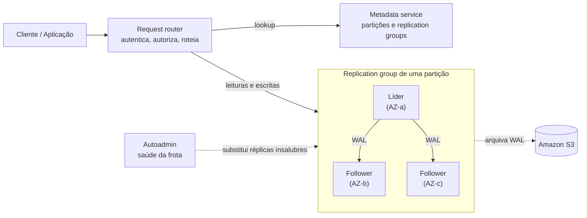

# Tolerância a Falhas com Amazon DynamoDB

[](https://aws.amazon.com/dynamodb/)
[](#9-referência)
[](#7-status-e-próximos-passos)
[](https://ic.ufal.br/)

Trabalho acadêmico da disciplina de **Sistemas Distribuídos**, no curso de **Bacharelado em Ciência da Computação** do **Instituto de Computação (IC)** da **Universidade Federal de Alagoas (UFAL)**.

**Professor:** Leandro Sales

---

## Sumário

- [1. Sobre o Trabalho](#1-sobre-o-trabalho)
- [2. Paper Base](#2-paper-base)
- [3. Arquitetura do DynamoDB em Resumo](#3-arquitetura-do-dynamodb-em-resumo)
- [4. Mecanismos de Tolerância a Falhas](#4-mecanismos-de-tolerância-a-falhas)
- [5. Simulação de Falhas](#5-simulação-de-falhas)
- [6. Infraestrutura](#6-infraestrutura)
- [7. Status e Próximos Passos](#7-status-e-próximos-passos)
- [8. Equipe](#8-equipe)
- [9. Referência](#9-referência)

---

## 1. Sobre o Trabalho

O trabalho estuda **como o Amazon DynamoDB tolera falhas sem perder dados confirmados**, a partir do paper que descreve a arquitetura do serviço (Elhemali et al., USENIX ATC 2022).

### Objetivos

- **Fundamentação teórica**: explicar os mecanismos de replicação, consenso e durabilidade descritos nas seções §3 (Arquitetura) e §5 (Durabilidade e corretude) do paper.
- **Mapa de falhas**: relacionar cada mecanismo ao tipo de falha que ele cobre, ao comportamento esperado e aos seus limites.
- **Simulação**: desenhar experimentos que observem, do lado do cliente, os efeitos desses mecanismos.

### Pergunta que guia o trabalho

> *"Data should never be lost after it has been committed."* (§5)
>
> Que mecanismos sustentam essa garantia, contra quais falhas e a que custo?

---

## 2. Paper Base

**Elhemali et al.** *Amazon DynamoDB: A Scalable, Predictably Performant, and Fully Managed NoSQL Database Service.* 2022 USENIX Annual Technical Conference (ATC '22), pp. 1037–1048.

| Seção do paper | Uso no trabalho |
|---|---|
| **§3 Arquitetura** | particionamento, replication groups, Multi-Paxos, lease de liderança, caminho de escrita, storage replica × log replica, microsserviços |
| **§5 Durabilidade e corretude** | WAL e arquivamento no S3, checksums, scrub, métodos formais, backup e point-in-time restore |
| **§6 Disponibilidade** (pontual) | quórum 2-de-3 em AZs distintas, detecção de falha cinzenta, entrega de liderança em deploy |

O material de estudo está em [`docs/paper/`](docs/paper/), em paráfrase do original com referências de seção (`§3`, `§5.1`). Os números do paper refletem o serviço em 2022 (por exemplo, a janela de 35 dias do PITR) e devem ser conferidos na documentação atual da AWS.

---

## 3. Arquitetura do DynamoDB em Resumo

Uma tabela é dividida em **partições**. Cada partição tem um **replication group** com réplicas em **Availability Zones diferentes**, e um líder eleito por **Multi-Paxos** atende as escritas e as leituras fortemente consistentes.



Pontos centrais:

- **A escrita é confirmada quando um quórum de réplicas persiste o registro no write-ahead log (WAL)**, e não quando a B-tree é atualizada. A durabilidade vem do log.
- **A unidade de falha é o replication group de uma partição**, nunca a tabela inteira.
- **Log replicas** guardam só o WAL recente e são adicionadas em segundos, cobrindo a janela em que uma storage replica está sendo reconstruída.

Detalhes em [`docs/paper/secao-3-arquitetura.md`](docs/paper/secao-3-arquitetura.md).

---

## 4. Mecanismos de Tolerância a Falhas

O paper organiza a perda de dados em quatro causas, cada uma com seus mecanismos:

| Causa | Mecanismos principais | Seção |
|---|---|---|
| **Falha de hardware** (disco, nó, AZ) | WAL em 3 réplicas, arquivamento no S3, log replica, autoadmin | §3, §5.1 |
| **Falha de liderança e de rede** | Multi-Paxos, leadership lease, quórum de escrita, confirmação entre pares | §3, §6 |
| **Erros silenciosos** (bit rot, bugs de hardware) | checksums em toda transferência, manifesto, verificação cruzada, scrub | §5.2, §5.3 |
| **Bugs de software** | TLA+ e model checking, failure injection, power-off tests | §5.4 |
| **Corrupção lógica** (erro da aplicação) | backup on-demand, point-in-time restore, escrita condicional, transações | §3, §5.5 |

### Limites discutidos no trabalho

1. **Durabilidade e disponibilidade são negociadas.** Sem quórum, a partição fica indisponível para escrita em vez de aceitar uma escrita insegura.
2. **A janela do lease é indisponibilidade de projeto.** Ela evita dois líderes ao custo de alguns segundos sem escrita.
3. **O WAL ainda não arquivado é o ponto mais frágil.** É esse intervalo que a log replica protege.
4. **Detectar não é corrigir.** Checksum e scrub encontram o erro; a correção vem de outra cópia.
5. **Nada em §5.1–§5.4 protege contra erro da aplicação.** Para isso existe o restore (§5.5).

O mapa completo (mecanismo → falha, falha → cadeia de reação e limites) está em [`docs/paper/mapa-conceito-cenario-falha.md`](docs/paper/mapa-conceito-cenario-falha.md).

---

## 5. Simulação de Falhas

> [!IMPORTANT]
> No DynamoDB gerenciado, o cliente **não consegue** derrubar storage nodes, forçar eleição de líder ou corromper um disco. Os mecanismos internos não são injetáveis: só os seus **efeitos de ponta a ponta** podem ser observados.

Cenários do laboratório (detalhes de parâmetros e métricas em [`docs/CONTRATOS.md`](docs/CONTRATOS.md)):

| Cenário | O que provoca | O que mede | Paper |
|---|---|---|---|
| **A** — atomicidade | transferência de unidades entre dois produtos cuja segunda escrita falha, com e sem TransactWriteItems | unidades perdidas na transferência | §3 |
| **B** — throttling | 100 vendas no mesmo produto em tabela de 1 WCU, sem retry e depois com backoff exponencial | vendas perdidas e tentativas por fase | §4 |
| **C** — conflito | duas regiões vendendo o mesmo produto ao mesmo tempo, com e sem escrita condicional | sobrevendas e tempo de convergência | §3 |
| **D** — recuperação | zera a quantidade de 40 produtos e restaura por PITR em tabela nova | divergências e valor de estoque antes e depois | §5.5 |

> [!LIMITAÇÃO DE AMBIENTE] A conta da AWS disponível não suporta recursos entre regiões, o que inviabilizou Global Tables. A promessa de disponibilidade sob falha de região (§6.1) é tratada apenas na fundamentaçãpo teórica, sem medição. Ver [`docs/RISCOS.md`](docs/RISCOS.md))
---

## 6. Infraestrutura

A infraestrutura é descrita em Terraform e verificada por scripts Python:

```text
terraform/   tabela global Estoque em us-east-2 (PITR, streams) e tabela EstoqueThrottle (1 WCU)
scripts/     01_setup_table.py (verifica), 02_seed_data.py (50 produtos × 100 unidades), 03_reset.py
lab/         código comum: configuração e acesso ao DynamoDB
```

Cada item gravado leva `versao`, `atualizado_em` e `regiao_escrita`, para que os logs dos experimentos identifiquem Região, versão e momento de cada escrita.

O passo a passo (criar, popular, resetar, destruir e controlar custo) está em [`docs/RUNBOOK.md`](docs/RUNBOOK.md).

---

## 7. Status e Próximos Passos

- [x] Estudo dirigido da §3 (Arquitetura) e da §5 (Durabilidade e corretude)
- [x] Mapa conceito → cenário de falha
- [x] Terraform e scripts de setup, seed e reset (escritos; falta aplicar na AWS)
- [ ] Conta AWS do grupo com credenciais em us-east-2 e alerta de custo
- [ ] Infraestrutura aplicada e seed validado em us-east-2
- [ ] Implementação dos cenários de falha
- [ ] Backend e dashboard
- [ ] Coleta e análise dos resultados
- [ ] Relatório final, vídeo e apresentação

---

## 8. Equipe

- **Anna Beatriz Bernardo** ([@nanameetscode](https://github.com/nanameetscode))
- **Andrey Noewertton** ([@AndyFerr](https://github.com/AndyFerr))
- **Marcos Ryan**

Instituto de Computação (IC) — **Universidade Federal de Alagoas (UFAL)**.

---

## 9. Referência

Mostafa Elhemali, Niall Gallagher, Nicholas Gordon, Joseph Idziorek, Richard Krog, Colin Lazier, Erben Mo, Akhilesh Mritunjai, Somu Perianayagam, Tim Rath, Swami Sivasubramanian, James Christopher Sorenson III, Sroaj Sosothikul, Doug Terry, Akshat Vig. **Amazon DynamoDB: A Scalable, Predictably Performant, and Fully Managed NoSQL Database Service.** In: *2022 USENIX Annual Technical Conference (USENIX ATC '22)*, pp. 1037–1048.
