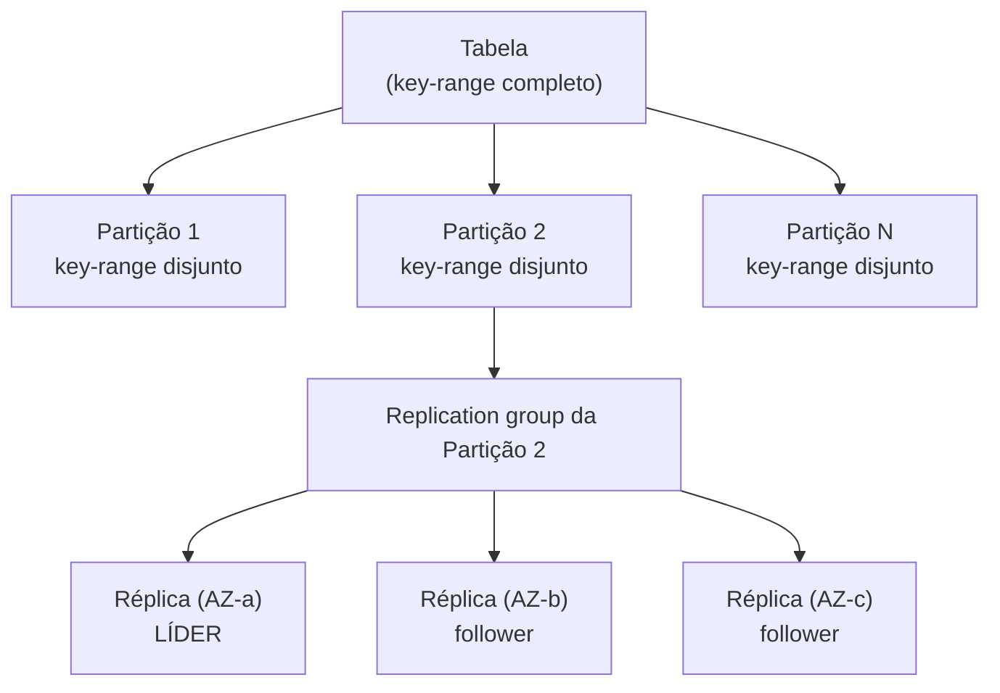
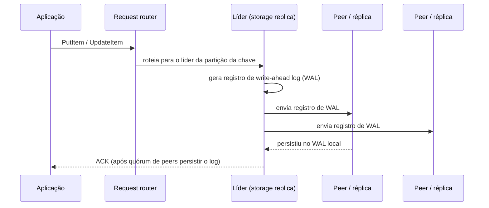
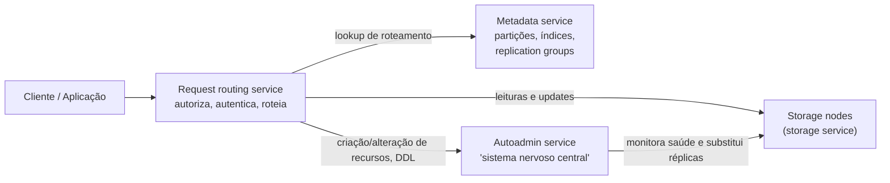

# §3 — Arquitetura do DynamoDB (estudo dirigido)

> Fonte: Elhemali et al., *Amazon DynamoDB: A Scalable, Predictably Performant, and Fully Managed NoSQL Database Service*, USENIX ATC 2022, §3 (pp. 1039–1040).
> Todo o conteúdo abaixo é paráfrase; as referências `§x.y` apontam para o trecho original.

---

## 1. Modelo de dados (o que é "um dado" aqui)

| Nível | Definição no paper |
|---|---|
| Tabela | coleção de *itens* |
| Item | coleção de *atributos*, identificado unicamente por uma **chave primária** |
| Chave primária | definida na criação da tabela: só **partition key**, ou **partition key + sort key** (chave composta) |

Regras que importam para o resto da arquitetura:

- O valor da **partition key sempre passa por uma função de hash interna**. A saída do hash, somada ao valor da sort key (quando existe), determina **onde o item é armazenado**.
- Em tabela com chave composta, vários itens podem compartilhar a mesma partition key — mas precisam ter sort keys diferentes.
- **Índices secundários** permitem consultar por uma chave alternativa, além da chave primária. Uma tabela pode ter um ou mais.

> **Por que isso é relevante para tolerância a falhas:** a chave decide a partição, a partição decide o grupo de replicação, e o grupo de replicação é a unidade de falha e de recuperação. Falha nunca é "a tabela caiu" — é "um grupo de replicação de uma partição perdeu réplicas".

---

## 2. API de dados (§3, Tabela 1)

| Operação | O que faz |
|---|---|
| `PutItem` | insere um item novo, ou substitui um item antigo por um novo |
| `UpdateItem` | atualiza um item existente, ou cria o item se ele não existir |
| `DeleteItem` | apaga um único item pela chave primária |
| `GetItem` | retorna um conjunto de atributos do item com a chave primária dada |

Dois pontos adicionais:

- Qualquer operação de inserção, atualização ou remoção pode levar uma **condição** que precisa ser satisfeita para a operação ter sucesso (escrita condicional).
- O DynamoDB suporta **transações ACID** entre múltiplos itens, sem comprometer escalabilidade, disponibilidade e performance das tabelas.

---

## 3. Particionamento

Uma tabela é dividida em **múltiplas partições** para atender aos requisitos de throughput e de armazenamento.

- Cada partição hospeda uma faixa de chaves (**key-range**) **disjunta e contígua** da tabela.
- Cada partição tem **múltiplas réplicas distribuídas em diferentes Availability Zones** (AZs) — é isso que dá alta disponibilidade e durabilidade.
- O conjunto de réplicas de uma partição forma um **replication group** (grupo de replicação).



---

## 4. Consenso: Multi-Paxos e o lease de liderança

O grupo de replicação usa **Multi-Paxos** (Lamport) para **eleição de líder e consenso**.

Mecânica descrita no paper:

1. **Qualquer réplica** pode disparar uma rodada de eleição.
2. Eleita líder, a réplica **mantém a liderança enquanto renovar periodicamente seu *leadership lease*** (contrato de liderança por tempo).
3. Se o líder for **detectado como falho** (considerado insalubre ou indisponível) por **qualquer um** dos seus pares, esse par pode propor uma nova rodada de eleição **para eleger a si mesmo** como novo líder.
4. O **novo líder não atende escritas nem leituras consistentes até o lease do líder anterior expirar**.

> **Ponto de prova para o trabalho:** o item 4 é a origem de uma indisponibilidade *de projeto*, não de um bug. Existe uma janela de alguns segundos em que a partição não aceita escrita nem leitura forte, por segurança (evitar dois líderes). Em §6.2 o paper detalha o custo disso e como falsos positivos de detecção de falha pioram o problema.

---

## 5. Caminho de leitura e de escrita

**Quem pode servir o quê:**

| Tipo de requisição | Quem atende |
|---|---|
| Escrita | **somente o líder** |
| Leitura fortemente consistente | **somente o líder** |
| Leitura eventualmente consistente | **qualquer réplica** do grupo |

**Fluxo de uma escrita (§3):**



O ponto central: a escrita é confirmada à aplicação **assim que um quórum de peers persistiu o registro de log no seu write-ahead log local** — não depois de atualizar a B-tree de todos. Durabilidade vem do log, não da estrutura de dados indexada.

> Complemento de §6.1 (fora do escopo desta seção, mas necessário para o trabalho): um **quórum de escrita saudável no DynamoDB são 2 das 3 réplicas, em AZs diferentes**. A partição continua disponível para escrita enquanto houver réplicas suficientes para o quórum **e** um líder.

---

## 6. Anatomia das réplicas: *storage replica* vs *log replica*

Essa distinção é a peça mais importante da §3 para o tema do trabalho.

```
STORAGE REPLICA (Figura 2 do paper)        LOG REPLICA (Figura 3 do paper)
┌──────────────────────────────┐           ┌──────────────────────────────┐
│  write-ahead log (WAL)       │           │  write-ahead log (WAL)       │
│  ─────────────────────────── │           │  apenas entradas recentes    │
│  B-tree                      │           │                              │
│  (dados chave-valor)         │           │  (SEM dados chave-valor)     │
└──────────────────────────────┘           └──────────────────────────────┘
 roda em storage node                       roda em log node
 pode virar líder / servir leitura          papel ≈ acceptor do Paxos
```

- Um grupo de replicação é formado por **storage replicas**, que contêm **tanto o WAL quanto a B-tree** com os dados chave-valor.
- Para **melhorar disponibilidade e durabilidade**, o grupo **também pode conter réplicas que só persistem entradas recentes do WAL**: as **log replicas**.
- **Log replicas são análogas aos *acceptors* do Paxos** e **não armazenam dados chave-valor**.
- O próprio paper remete a §5 e §6 para explicar como as log replicas melhoram durabilidade e disponibilidade — é exatamente a ponte entre §3 e §5.

---

## 7. Microsserviços (Figura 4)

O DynamoDB é composto de **dezenas de microsserviços**. Os principais:



| Serviço | Responsabilidade (§3) |
|---|---|
| **Metadata service** | guarda informação de roteamento: tabelas, índices e replication groups das chaves de uma tabela/índice |
| **Request routing service** | autoriza, autentica e roteia cada requisição; consulta o metadata service; manda leitura/update para os storage nodes que hospedam os dados |
| **Storage service** | armazena os dados do cliente em uma frota de storage nodes; **cada storage node hospeda muitas réplicas de partições diferentes** |
| **Autoadmin service** | saúde da frota, saúde das partições, scaling de tabelas e execução de **todas** as requisições de control plane |

**Autoadmin em detalhe** (é o componente de recuperação automática):

- Monitora **continuamente** a saúde de todas as partições e **substitui qualquer réplica considerada insalubre** — lenta, não responsiva, ou hospedada em hardware ruim.
- Faz health check de todos os componentes centrais do DynamoDB e **substitui hardware que falhou ou está falhando**.
- Exemplo dado no paper: se o autoadmin detecta um storage node insalubre, ele **dispara um processo de recuperação que substitui as réplicas hospedadas nesse node**, trazendo o sistema de volta a um estado estável.

Outros serviços não mostrados na Figura 4 sustentam: point-in-time restore, backups on-demand, update streams, global admission control, global tables, índices secundários globais e transações.

---

## 8. Perguntas de verificação (§3)

1. Por que a escrita é confirmada ao cliente antes de a B-tree de todas as réplicas estar atualizada? → porque a durabilidade é garantida pelo **WAL persistido em quórum**; a B-tree é a estrutura de consulta, não o registro de verdade.
2. Por que uma log replica é criada em segundos e uma storage replica leva minutos? → ver §5.1: a log replica copia **só o WAL recente**; a storage replica exige copiar **B-tree + WAL**.
3. O que acontece com leitura eventualmente consistente durante uma eleição de líder? → continua sendo atendida por qualquer réplica; só escrita e leitura forte param.
4. Quem decide trocar uma réplica ruim: o líder do grupo ou o autoadmin? → ambos, em papéis diferentes. O **líder** adiciona **log replica** (reação rápida, segundos, §5.1). O **autoadmin** faz a substituição definitiva de réplicas/hardware (§3).
5. Por que o novo líder espera o lease do antigo expirar? → para impedir dois líderes simultâneos atendendo escrita/leitura forte (segurança do Multi-Paxos), ao custo de alguns segundos de indisponibilidade.
